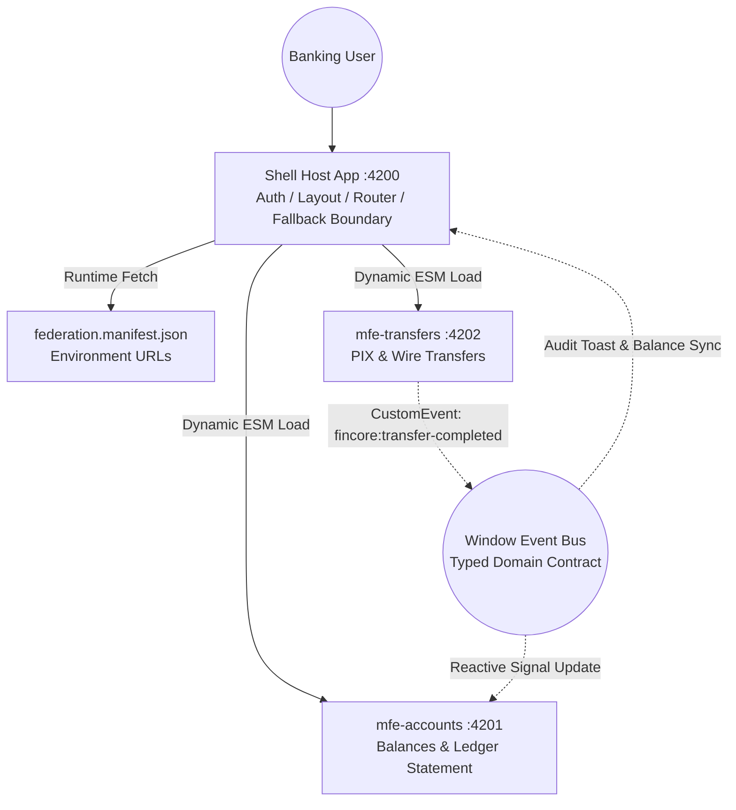

# 🏦 FinCore MFE — Enterprise Banking Micro Frontend Architecture

> **Reference Architecture & Production-Ready MVP** demonstrating **Angular 18+ Standalone**, **Native Federation (`@angular-architects/native-federation`)**, **Signals**, **SOLID Principles**, **Runtime Manifest Discovery**, and **Zero-Coupling Cross-MFE Event Bus**.

Built to reflect enterprise banking front-end standards: independent deployments, fault-tolerant lazy remote loading with circuit-breaker fallbacks, shared design tokens, and strict TypeScript domain contracts.

---

## 📐 System Architecture



### Key Architectural Decisions

1. **Native Federation over Webpack Module Federation:** Uses standard ES Modules (ESM) and Import Maps, decoupling the micro frontend architecture from Webpack and enabling seamless builds with Angular's modern `esbuild` application builder.
2. **Runtime Environment Discovery (`federation.manifest.json`):** Remote entry URLs are resolved at runtime rather than hardcoded at build time—allowing the exact same Docker/Azure DevOps build artifact to promote across `Dev -> Staging -> Production`.
3. **Fault-Tolerant Remote Boundary (`RemoteFallbackComponent`):** If `mfe-transfers` or `mfe-accounts` is offline or fails network resolution, the `shell-host` catches the dynamic import rejection gracefully without crashing the host application.
4. **Decoupled Cross-MFE Communication (`@fincore/mfe-contracts`):** Micro frontends never import services directly from each other. State synchronization (e.g., completing a PIX transfer in `mfe-transfers` immediately updating the checking balance and ledger in `mfe-accounts`) happens via strongly typed `CustomEvent` contracts.
5. **SOLID & Clean Layering inside each MFE:**
   - `domain/`: Pure TypeScript interfaces, value objects, and validation rules (Zero Angular dependencies).
   - `application/`: Reactive Signal-based facades and use-case orchestrators.
   - `infrastructure/`: Typed HTTP repositories, Azure-ready Bearer token interceptors, and Event Bus adapters.
   - `presentation/`: Pure standalone UI components with `OnPush` change detection.

---

## 🗂️ Monorepo Structure

```text
angular-native-federation-banking-mfe/
├── packages/
│   └── mfe-contracts/           # Shared TypeScript interfaces & CustomEvent bus definitions
├── apps/
│   ├── shell-host/              # Host App (Port 4200) - Topbar, Sidebar, Auth Context & Dynamic Router
│   ├── mfe-accounts/            # Remote 1 (Port 4201) - Account Summary, Balance & Filterable Statement
│   └── mfe-transfers/           # Remote 2 (Port 4202) - PIX / TED Transfer Wizard with Validation
├── azure-pipelines.yml          # CI/CD pipeline matrix for independent MFE builds & testing
└── package.json                 # Concurrent orchestration scripts
```

---

## 🚀 Quick Start (Local Development)

### Prerequisites
- **Node.js** `>= 20.11.0`
- **npm** `>= 10.0.0`

### 1. Install dependencies across all apps
```bash
npm run install:all
```

### 2. Run all 3 Micro Frontends simultaneously
```bash
npm start
```
This boots:
- **Shell Host:** `http://localhost:4200`
- **MFE Accounts (Remote):** `http://localhost:4201`
- **MFE Transfers (Remote):** `http://localhost:4202`

### 3. Test Fault Tolerance (Resilience Demo)
Stop `mfe-transfers` (`Ctrl+C` on port 4202) while keeping `shell-host` running on `4200`. Navigate to **PIX & Transfers** in the Shell menu—the Shell catches the remote failure and renders a graceful fallback recovery screen while **Accounts & Statement** continues operating normally.

---

## 🧪 Unit Testing & CI/CD

Each micro frontend includes isolated unit tests (Jasmine/Karma & Cypress E2E readiness) and an `azure-pipelines.yml` configured for parallel matrix builds in **Azure DevOps**.

```bash
npm test
```

---

## 👩‍💻 Author

**Thamires Vasconcelos** — Front-End Engineer  
[GitHub](https://github.com/Thamiresvs) • [LinkedIn](https://www.linkedin.com/in/thamiresvasconcelos/)
